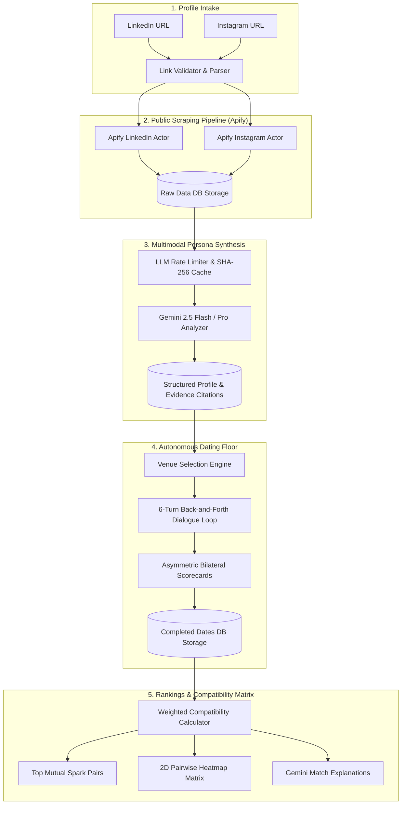

# AgentMatch 💖🤖
> **Autonomous AI Dating Simulation Platform for Real People**  
> *AI agents analyze public LinkedIn & Instagram profiles, date on behalf of real people, and calculate genuine mutual compatibility rankings.*

---

## 🌟 Overview

Modern dating is plagued by swipe fatigue, superficial bios, and mismatched conversations. **AgentMatch** reimagines matchmaking by deploying **autonomous AI agents** representing real people:

1. **Intake**: Paste a public LinkedIn URL and a public Instagram URL per person (single form or bulk paste). The two links are the *only* sources.
2. **Scrape**: Apify cloud actors pull the public LinkedIn profile (headline, about, experience, education + activities, volunteering, causes, honors, recommendations) and the public Instagram profile (bio, 12 latest posts: captions, hashtags, locations, tagged accounts, images).
3. **Agent reads its person**: Gemini (multimodal, sees the Instagram images) builds the persona — needs, hobbies, interests, values, personality traits, communication style, lifestyle, what they're looking for, deal-breakers — and every claim carries an evidence citation back to LinkedIn or Instagram.
4. **Agents pre-screen**: each agent scans the whole pool against its person's needs/values/hobbies/deal-breakers and books dates with its best fits (`DATES_PER_PERSON`, default 4; every agent gets dates).
5. **Agents date**: the two agents meet at a venue picked for both, then talk for 6 alternating turns. Each agent speaks as its person, references real facts from their profiles, and has a mission: check its person's needs are met and probe a deal-breaker.
6. **Private scorecards**: after the date each agent scores the other independently (shared interests, values, lifestyle, chemistry, needs met, deal-breaker check, overall 0–100 + reasoning).
7. **Ranking**: for every person, everyone else is ranked. People they dated come first, by $0.6 \times \text{score they gave} + 0.4 \times \text{score they received}$; the rest follow with the agent's pre-screen estimate, clearly labelled "not dated".

---

## 🏗️ System Architecture



---

## 🧠 Core Engine Components

### 1. Public Scraping Pipeline (Apify)
- **Cookie-less Extraction**: Extracts strictly public data without authenticating user sessions or storing credentials.
- **LinkedIn Worker**: `harvestapi/linkedin-profile-scraper` (no cookies; fallback `dev_fusion/Linkedin-Profile-Scraper`, override with `LINKEDIN_ACTOR`). Work history, skills, education + activities, volunteering, causes, honors, recommendations.
- **Instagram Worker**: `apify/instagram-profile-scraper`. Bio, category, latest 12 posts with captions, hashtags, locations, tagged users and image URLs (images are sent to Gemini).
- **Private Instagram**: detected and flagged (`instagram_private`) — only public profiles are analyzed.
- **Deduplication & Caching**: Scraped raw payloads are stored in the `raw_data` SQLite/PostgreSQL table to prevent redundant scraping.

### 2. Rate-Limited LLM Engine (`lib/llm/`)
- **Exponential Backoff & Jitter**: Automatically retries 429 rate limits and 503 service overloads with randomized backoff.
- **SHA-256 DB Cache**: Prompts and system instructions are hashed; responses are saved to the `llm_cache` table to guarantee instant responses on cache hits and zero cost for repeated runs.
- **Key Rotation**: Supports comma-delimited `GEMINI_API_KEY=key1,key2,key3` for round-robin load distribution.
- **Model Flexibility**:
  - `GEMINI_MODEL_ANALYSIS` (default: `gemini-3.8-flash`): Strict JSON extraction for structured personas.
  - `GEMINI_MODEL_DATING` (default: `gemini-3.5-flash-lite`): Conversational dialogue and bilateral scoring.
  - `GEMINI_MODEL_FALLBACK` (default: `gemini-3.5-flash-lite`): used automatically if a model is overloaded or retired.

### 3. Dating Engine & Compatibility Formula
Each date executes across 6 consecutive turns:
1. **Venue Synthesis**: Based on combined hobbies and aesthetic vibes (e.g. *"Rye & Record Ferment Bar"*, *"Independent Bookstore Cafe"*).
2. **Multi-Turn Chat**: Back-and-forth dialogue respecting each persona's communication style, humor, and conversational pace.
3. **Bilateral Asymmetric Scorecards**: Evaluates:
   - **Overall Score** (0–100)
   - **Conversational Chemistry** (0–100)
   - **Lifestyle Alignment** (0–100)
   - **Values Alignment** (0–100)
   - **Second Date Decision** (`YES`, `MAYBE`, `NO`)
   - **Highlights & Red Flags**

#### Compatibility Ranking Formula
$$\text{Composite Score} = 0.6 \times (\text{Score Given}) + 0.4 \times (\text{Score Received})$$

- **Mutual Spark**: Both agents scored each other $\ge 75\%$.
- **High Compatibility**: Weighted composite $\ge 75\%$.
- **One-Sided Interest**: Divergence $|\text{Score Given} - \text{Score Received}| \ge 25$.
- **Good Potential**: Weighted composite $55\% - 74\%$.
- **Low Alignment**: Weighted composite $< 55\%$.

---

## 🚀 Quickstart & Setup

### Prerequisites
- Node.js 18.x or 20.x
- NPM or PNPM
- Google Gemini API Key ([Google AI Studio](https://aistudio.google.com/))
- Apify API Token ([Apify Console](https://console.apify.com/))

### Installation

1. **Clone the repository**:
   ```bash
   git clone https://github.com/your-username/agentmatch.git
   cd agentmatch
   ```

2. **Install dependencies**:
   ```bash
   npm install
   ```

3. **Configure Environment Variables**:
   Create a `.env.local` file in the root directory:
   ```env
   # Database (PostgreSQL, e.g. Supabase)
   DATABASE_URL="postgresql://...:6543/postgres?pgbouncer=true"
   DIRECT_URL="postgresql://...:5432/postgres"

   # Google Gemini LLM
   GEMINI_API_KEY="your_gemini_api_key_here"
   GEMINI_MODEL_ANALYSIS="gemini-3.8-flash"
   GEMINI_MODEL_DATING="gemini-3.5-flash-lite"

   # Apify Scraper
   APIFY_TOKEN="your_apify_api_token_here"

   # App Config
   NEXT_PUBLIC_APP_URL="http://localhost:3000"
   ```

4. **Initialize Database Schema**:
   ```bash
   npx prisma db push
   ```

5. **Start Development Server**:
   ```bash
   npm run dev
   ```
   Open [http://localhost:3000](http://localhost:3000) in your browser.

---

## ⚡ The 25-person example

`data/people-25.txt` holds the 25 real people used in the demo (name, LinkedIn, public Instagram). Paste it into **People → Bulk** and press **Run full pipeline**, or open `/demo` to view the finished, exported run (`data/demo-snapshot.json`) without typing anything.

To try your own person: add their two links on **People**, click **Scrape** then **Analyze**, open their profile and press **Send My Agent on Dates** — their agent dates its top 3 picks live and the rankings refresh.

---

## 📡 API Reference

| Endpoint | Method | Description |
|---|---|---|
| `/api/health` | `GET` | System diagnostics & API key status |
| `/api/people` | `GET`, `POST` | List all candidates or add single/bulk profiles |
| `/api/people/[id]` | `GET`, `DELETE` | Retrieve candidate details or delete profile |
| `/api/scrape/[id]` | `POST` | Trigger Apify scraping for a candidate |
| `/api/analyze/[id]` | `POST` | Run Gemini persona synthesis on scraped data |
| `/api/dates` | `GET`, `POST` | List completed dates or trigger a new speed date |
| `/api/dates/[id]` | `GET` | Get full date transcript and scorecards |
| `/api/dates/stream` | `GET` | SSE live dates. `?person=<id>` = that agent dates its top 3; `?ids=a,b,c` = a test group; none = full agent schedule |
| `/api/rankings` | `GET`, `POST` | Get or recalculate compatibility matrix and rankings |
| `/api/pipeline/run` | `GET` | SSE stream running end-to-end pipeline (Scrape &rarr; Analyze &rarr; Date &rarr; Rank) |
| `/api/demo/export` | `GET` | Export live database to `data/demo-snapshot.json` |
| `/api/demo/seed` | `POST` | Populate live database with initial analyzed pool |

---

## 🔒 Privacy & Ethical AI Manifesto

- **Public Profiles Only**: AgentMatch only extracts information publicly available on LinkedIn and Instagram.
- **No Private Credentials**: Users never enter account passwords, session tokens, or private messages.
- **Evidence-Grounded**: Every persona trait and preference is tied to explicit public evidence citations to prevent hallucination.
- **Transparent Reasoning**: Complete date transcripts and score breakdowns are visible to users.

---

## 🛠️ Tech Stack

- **Framework**: [Next.js 14 (App Router)](https://nextjs.org/)
- **Language**: [TypeScript](https://www.typescriptlang.org/)
- **Styling**: [Tailwind CSS](https://tailwindcss.com/) & [Lucide Icons](https://lucide.dev/)
- **ORM / Database**: [Prisma](https://www.prisma.io/) (SQLite / PostgreSQL)
- **AI / LLM**: [Google Gemini SDK (@google/genai)](https://ai.google.dev/)
- **Web Scraping**: [Apify Client SDK](https://apify.com/)
- **Real-time Streaming**: Server-Sent Events (SSE)

---

## 📄 License

MIT License &copy; 2026 AgentMatch. All rights reserved.
